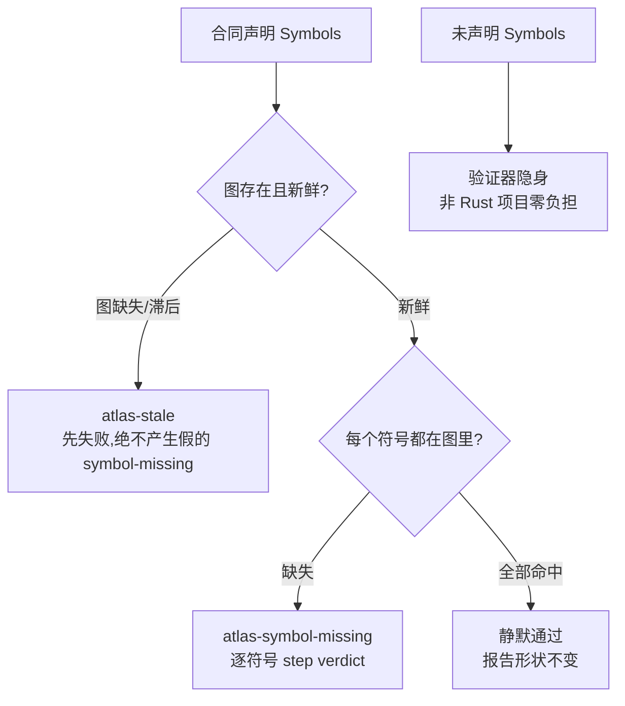

# 第 8 章 边界、守卫与符号

> **定位**：本章覆盖变更集执法（BoundariesVerifier）、全仓守卫（guard）与
> 1.0 的符号验证（`### Symbols`，Intent-Code Linker 的入口）。
> 前置依赖：第 7 章。基于 agent-spec 1.0.0。

## 变更集从哪来

边界执法需要知道"这次改了哪些文件"：

| 旗标 | 行为 |
|------|------|
| `--change <path>` | 显式指定文件/目录 |
| `--change-scope staged` | Git 暂存区（guard 默认）|
| `--change-scope worktree` | 全部工作区变更 |
| `--change-scope jj` | Jujutsu 变更（jj 仓库自动适用）|
| `--change-scope none` | 不做变更检测（lifecycle 默认）|

BoundariesVerifier 把每个变更文件对照合同的 glob：命中禁止 → fail；有允许清单
却不在其中 → fail；证据（PatternMatch）逐文件记录。

## guard：全仓一次验证

```bash
agent-spec guard --spec-dir specs --code . --change-scope staged   # pre-commit
agent-spec guard --spec-dir specs --code . --change-scope worktree # CI
```

```text
agent-spec guard: 55 spec(s) passed
```

这行输出来自 agent-spec 自己的仓库（写作时快照；活跃合同数会随仓库生长）——
全部活跃合同在每次提交前复验。
任何一份合同 lint 不过或验证不过，提交被阻断；失败时 guard 会在该合同的汇总行下
列出每个 `fail` / `uncertain` 场景的 selector、退出码与输出最后 40 行。

### 每份合同只管自己的领地

guard 不再拿整次提交的变更集去对照每一份活跃合同。一份合同的 `Forbidden` 与
`Allowed changes` 只约束**触及其领地**的提交——某个变更命中它的允许清单，或者
就是它的合同文件（含从 `specs/roadmap/` 晋升时的源路径）：

| 提交内容 | 结果 |
|---|---|
| 只改文档、CI 配置，或只改 `knowledge/` 的治理提交 | 不触及任何合同，不做边界检查 |
| 改动分属两份合同的领地 | 各自在边界内，通过 |
| 触及某合同领地，同时夹带一个无人认领的路径 | 该路径对每份被触及的合同都算越界 |
| 触及合同 A 的领地，同时改了 A 禁止的路径 | A 报 forbidden |

`--strict-boundaries` 保留旧行为：每份合同对照整个变更集。

### 批量执行

绑定测试按 (package, features) 分组，guard 跨全部活跃合同合并分组，每组只调用
一次 `cargo test --no-fail-fast -- <filter…>`，再按 libtest 的逐测试结果行把判定
回填到各场景（测试路径包含 filter 即归属该场景）。默认 `--test-threads=1`；
`--test-threads <N>` 调并发，`--no-batch` 退回每个场景一次 `cargo test -q`。

### 测试结果的来源

批量执行默认用 `cargo test`。另有两种来源，判定规则完全相同（同一个判定函数）：

| 参数 | 做法 | 适用 |
|---|---|---|
| `--runner nextest` | 每组一次 `cargo nextest run -E 'test(~<filter>) \| …'`，从它写出的 JUnit 报告读结果；测试二进制之间并行 | 测试二进制多而慢、本地或 soak 仍要现场运行时 |
| `--test-results <junit.xml>`（可重复） | 不编译、不运行，按报告判定：`Package: P` 匹配二进制 id 为 `P` 或 `P::…` 的用例，filter 按子串匹配 | CI 里前一个作业已经跑完全部测试并留下报告时 |

报告不记录运行时开启的 cargo features，用 `--test-results-features <pkg/feature,…>`
声明：声明了 `Features:` 而未被覆盖的场景判 `uncertain`（`results-feature-mismatch`），
未声明 features 的场景按报告判定。guard 的汇总行写明用了几份报告、多少用例、哪些
features。报告是否来自同一提交由调用方负责——只用同一条流水线里的作业产物。

```bash
# CI：test 作业已用 nextest 跑完并写出 target/nextest/ci/junit.xml
agent-spec guard --spec-dir specs --code . \
  --test-results target/nextest/ci/junit.xml \
  --test-results-features my-crate/test-hooks
```

## `### Symbols`：把合同钉到真实符号上

1.0 的合同可以在边界下声明代码符号引用：

```markdown
## Boundaries

### Allowed Changes
- src/**

### Symbols
- rust-atlas: spec_verify::Verifier
- rust-atlas: spec_knowledge::build_work_units
```

lifecycle 管线中的 Atlas 符号验证器会拿**新鲜图**逐一核对：



三条语义值得背下来：**stale 优先**（图滞后时不指控符号缺失）；**全对即静默**
（不给报告添噪音）；**不声明即免税**（没有 Symbols 的合同永远不需要图）。
"合同里提到的符号已经不存在了"从此是机械诊断，不是考古发现——这是
Intent-Code Linker 的第一块（架构全景详见第 19 章，图的构建详见第 16 章）。

## VCS 感知

`.jj/` 存在（哪怕同时有 `.git/`）就用 `--change-scope jj`，且不要跑
`git add`——jj 自动快照。`stamp` 在 jj 仓库会带 `Spec-Change:` trailer；
`explain --history` 可通过 operation id 给出运行间的文件级 diff
（这两个命令详见第 9 章）。
