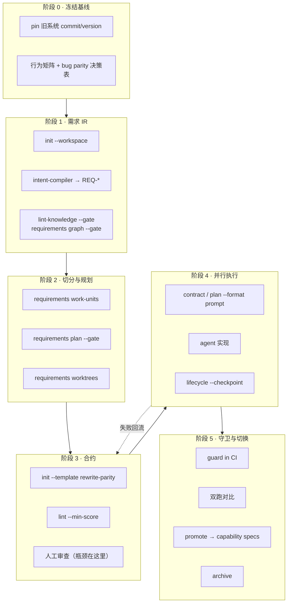

# 项目重写执行手册

> 用 `agent-spec` 把一次完整的项目重写（rewrite / port / parity migration）
> 变成一条可验证的流水线：**旧系统是 oracle，行为等价是可机械检验的目标。**

本手册面向「把一个已有项目（含开源项目）整体重写为新实现」的场景，给出从
可行性判断到切换收尾的完整执行路径。每条命令都可直接运行。

---

## 0. 先判断可行性

### 0.1 重写为什么适合 spec 驱动

`agent-spec` 的核心限制是：它验证「代码是否满足合约」，不判断「合约描述的产品对不对」
（见 [`README.md`](../README.md) 的 *What agent-spec doesn't solve* 一节，
「Cold-start product judgment」条）。**这个限制在重写场景下自动消失**，
因为旧系统本身就是行为基准（oracle）：

| 常规开发 | 重写 |
|---|---|
| 合约是否描述了正确的产品？——需要产品判断 | 合约是否复刻了旧系统的可观察行为？——可机械检验 |
| 场景从需求想象中来 | 场景从旧系统实测中来 |
| 「做完了吗」靠人判断 | 「做完了吗」= parity 矩阵是否全绿 |

结论：**重写是 agent-spec 最成立的用法**，比给已有项目补 spec 更成立。

### 0.2 语言矩阵（硬约束，先看这个）

`agent-spec` 的测试绑定验证依赖 `collect_test_function_names`
（[`src/spec_report/coverage.rs:198`](../src/spec_report/coverage.rs)），
当前只扫描 `.rs` 文件、只识别 `#[test]` 属性。`matrix`、`audit`、`discover`
共用这一条通路，`atlas` 也只有 Rust provider。

因此：

| 位置 | 语言 | 支持程度 |
|---|---|---|
| **源项目**（被重写方） | Rust | `discover --from-codebase` 可机械抽取场景骨架 |
| 源项目 | 非 Rust | `discover` 抽不到任何东西，走 §2.2 的人工/AI 提取路径 |
| **目标项目**（重写产物） | Rust | 完整能力：测试绑定、matrix、atlas、liveness |
| 目标项目 | 非 Rust | **降级**：保留合约、lint、边界守卫、需求 DAG；**失去测试绑定验证** |

> **目标语言不是 Rust 时请先读这一条**：你会失去 parity 重写最需要的那一层
> （场景 ↔ 测试的机械绑定）。合约仍有组织价值，但「全绿即等价」的保证不再成立，
> 需要在 CI 里自建场景名 ↔ 测试名的映射检查来补位。

当前工具形状是 **「X → Rust」重写**。[`examples/rewrite-parity-contract.spec`](../examples/rewrite-parity-contract.spec)
正是 JS CLI → Rust CLI 的实例，这不是巧合。

### 0.3 不要用这套流程的情况

- **想顺便重新设计产品**。parity 重写和产品重设计必须分两期做。混在一起，
  合约既无法对齐旧行为、又无法验证新设计，两头落空。先 parity，再演进。
- **旧系统没有稳定的可观察边界**（无 CLI、无 API、无稳定输出格式，只有内部函数）。
  没有可观察行为就没有可绑定的场景。
- **只想重写一个模块**。那不需要本手册，直接写单个 rewrite-parity 合约即可（§4）。

---

## 1. 阶段总览



**关键节奏**：阶段 0–3 是人的工作，阶段 4 是 agent 的工作。
低估阶段 0–3 是这类项目失败的主因。

---

## 2. 阶段 0：冻结行为基线

产物：一份**行为矩阵**和一张 **bug parity 决策表**。这一步没有捷径。

### 2.1 pin 住基线

```bash
# 把旧系统作为 submodule 或 vendored 副本钉在一个确定的 commit 上
git submodule add <upstream-url> baseline/
cd baseline && git checkout <commit-sha>
```

基线漂移是 parity 项目的隐形杀手。**基线必须是一个 commit sha，不是一个分支名。**
上游后续的改动统一进「基线升级」批次处理，不允许在重写过程中滚动跟进。

### 2.2 提取可观察行为

**源项目是 Rust**：

```bash
agent-spec discover --from-codebase \
  --code baseline/src \
  --name "<模块名>-parity" \
  --out specs/drafts/<模块名>-parity.spec.md
```

输出是每个测试函数一个已绑定场景，`意图`、`当`、`那么` 留空待填。
**这是可解析的起点，不是成品合约。**

**源项目不是 Rust**（多数情况）：`discover` 用不上，走这条路径 ——

1. 用 `/agent-spec-intent-compiler` skill，输入源：
   - `README` / 官方文档 / `--help` 全量输出
   - issue tracker 里描述行为的条目（尤其是 bug report，它们定义了边缘行为）
   - 旧测试文件（AI 读，人工审，不要机械抽取）
   - CHANGELOG（记录了行为变更史，能揭示哪些行为是刻意为之）
2. 对 CLI 类项目，直接录制真实输出作为 fixture：
   ```bash
   for cmd in <穷举命令矩阵>; do
     baseline/bin/tool $cmd           > fixtures/baseline/$cmd.human.txt 2>&1
     baseline/bin/tool $cmd --json    > fixtures/baseline/$cmd.json.txt  2>&1
   done
   ```
   录下来的 fixture 就是 parity 断言的黄金数据。

### 2.3 行为矩阵（必须穷举的维度）

来自 [`skills/agent-spec-authoring/references/patterns.md`](../skills/agent-spec-authoring/references/patterns.md)
的 Rewrite / Parity Checklist：

```
command       × output mode（human / --json / -o）
local         × remote
warm cache    × cold start
success       × partial failure × hard failure
CLI           × MCP（两个入口都公开时）
```

再补三个重写特有的：

```
默认值        × 显式传参（默认值漂移是最难发现的 parity 缺陷）
precedence    （配置文件 / 环境变量 / 命令行的覆盖顺序）
exit code     （不只是 stdout，退出码也是公开契约）
```

**判据**：这些维度如果只出现在 `## 已定决策` 里而没有落成 `场景`，合约不算完成。

### 2.4 bug parity 决策表

旧系统的 bug 也是行为，下游可能依赖它。parity 合约会忠实固化它们，
所以必须**逐条显式决策**，在写合约之前完成：

| 旧行为 | 是 bug？ | 下游依赖？ | 决策 | 落到哪里 |
|---|---|---|---|---|
| 空输入返回 exit 0 | 是 | 未知 | 保留 | `场景` + 注明 `parity-bug` |
| 超时后写入半截缓存 | 是 | 否 | **修复** | `## 排除范围` 注明偏离基线 |
| `--json` 省略 null 字段 | 否 | 是 | 保留 | `场景` |

> 没有这张表，重写的结局是：要么把旧 bug 全搬过来还不自知，
> 要么「顺手修了」然后打破下游。**每一处对基线的偏离都必须是一次显式决策。**

---

## 3. 阶段 1：需求 IR

### 3.1 铺工作区

```bash
agent-spec init --workspace
```

生成 KLL 规范目录树：

```
knowledge/
  requirements/   # REQ-* 需求文档（IR）
  decisions/      # ADR
  context/        # 背景与归档摘要
  standards/      # 规范
  proposals/
```

### 3.2 把行为矩阵编译成 REQ

用 `/agent-spec-intent-compiler` skill 起草，人工审核后落盘。
需求文档的结构（参考 [`knowledge/requirements/req-code-live-wiki.md`](../knowledge/requirements/req-code-live-wiki.md)）：

```markdown
---
kind: requirement
id: REQ-<AREA>-PARITY
title: "<区域> 行为等价"
status: proposed        # 人工 accept 后才进入执行
liveness: auto
tags: [rewrite, parity]
---

# <区域> 行为等价

## Problem
<为什么这块需要重写，基线是什么>

## Requirements
[REQ-<AREA>-PARITY-HUMAN-MODE] 人类模式输出 MUST 与基线 <sha> 逐字节一致。
[REQ-<AREA>-PARITY-JSON-MODE] `--json` 输出 MUST 保持字段集合与省略策略一致。
[REQ-<AREA>-PARITY-EXIT-CODE] 退出码 MUST 与基线一致。

## Scenarios
<可选，供 work-unit 判定 ready>

## Source Trace
<基线文件路径>
```

**每个 MUST 子句对应一条可观察行为，不对应一个旧模块。** 这一条决定整个项目的成败，
详见 §4.1。

### 3.3 门禁

```bash
agent-spec lint-knowledge --gate            # EARS / ISO-29148 / governance
agent-spec requirements graph --gate        # 依赖 DAG 校验（查环、查悬空依赖）
```

需求经人工评审后转为 accepted：

```bash
agent-spec requirements transition --id REQ-<AREA>-PARITY --to accepted \
  --reason "行为矩阵已覆盖 §2.3 全部维度，bug 决策表已签署"
```

> `status: proposed` 的需求不会产出可执行 work-unit。这是刻意的闸门 ——
> **人工 accept 是这条流水线里不可自动化的一环。**

---

## 4. 阶段 2：切分与规划

### 4.1 按可观察行为切，不按旧模块切

这是重写最常见的死法。

```
✗ 错误切法（照搬旧结构）              ✓ 正确切法（按可观察行为）
  WU-parse-module                       WU-cli-get-human-mode
  WU-cache-module                       WU-cli-get-json-mode
  WU-http-module                        WU-cold-start-fallback-order
  WU-cli-module                         WU-remote-failure-contract
```

左边的问题：
- 每个 unit 都无法独立验证（parse 单独做完，没有任何用户可见行为可断言）
- 把旧架构的缺陷原样搬进新系统 —— 重写的价值被清零
- 集成风险堆到最后一刻

右边是**垂直切片**：每个 unit 端到端穿透，独立可验证，做完就能拿去和基线对拍。

### 4.2 生成 work-unit 与规划 DAG

```bash
agent-spec requirements work-units --format json --out .agent-spec/work-units.json
agent-spec requirements plan --gate --format text
```

`work-units` 输出的 `status` 字段决定后续动作：

| status | 含义 | 动作 |
|---|---|---|
| `ready` | 依赖已满足、场景齐备 | 可以进入合约阶段 |
| `blocked` | 依赖未完成，或 `mode: missing_scenarios` | 补场景或先做前置 unit |
| `informational` | 无可执行内容 | 不参与调度 |

处理 blocked：

```bash
agent-spec requirements questions              # 导出澄清问题
agent-spec requirements explain-failure --id REQ-<X>
```

### 4.3 先出测试义务（重写场景的关键技巧）

```bash
agent-spec requirements test-obligations --format json --out .agent-spec/test-obligations.json
```

这个命令 **code-independent** —— 不需要目标代码存在。在重写场景下这意味着：
**在写第一行新代码之前，就能得到完整的测试清单**，
直接拿去和 §2.2 录制的 baseline fixture 对齐。

### 4.4 并行调度清单

```bash
agent-spec requirements worktrees \
  --base main \
  --path-prefix ../rewrite-worktrees \
  --format json --out .agent-spec/worktrees.json
```

每个 ready work-unit 一个 git worktree，互不干扰，可以并行投多个 agent。

---

## 5. 阶段 3：写 parity 合约

### 5.1 起草

```bash
agent-spec init --level task \
  --name "<work-unit 名>" \
  --template rewrite-parity \
  --lang zh
```

`rewrite-parity` 模板预置了行为矩阵提示和结构化测试选择器。骨架：

```spec
spec: task
name: "<work-unit 名>"
inherits: project
tags: [rewrite, parity]
satisfies: [REQ-<AREA>-PARITY]
---

## 意图
将 <基线命令> 的可观察行为迁移到新实现。基线：<upstream>@<sha>。

## 已定决策
- 兼容性基线以 <upstream>@<sha> 的可观察行为为准
- 偏离基线的项已在 bug parity 决策表中签署：<链接>
- 外部 I/O 用本地 stub / fixture 验证，不依赖真实网络或真实 HOME

## 边界
### 允许修改
- src/commands/get.rs
- tests/**
### 禁止做
- 不要修改已发布的 CLI flag
- 不要为了让测试通过而修改基线 fixture
### 排除范围
- 本任务未声明的新增功能

## 完成条件
场景: 人类模式保持兼容输出
  测试:
    包: <crate 名>
    过滤: test_get_human_mode_parity
    层级: cli
    替身: fixture_cache
    命中: src/commands/get.rs, tests/cli_get.rs
  假设 内容已缓存
  当 用户以默认人类模式执行命令
  那么 stdout 与基线 fixture 逐字节一致
  而且 exit code 为 0
```

完整参考：[`examples/rewrite-parity-contract.spec`](../examples/rewrite-parity-contract.spec)。

### 5.2 结构化测试选择器

parity 合约建议一律用结构化形式而非 `测试: test_name` 简写，因为重写场景需要
显式记录**验证层级**和**替身策略**：

```spec
  测试:
    包: <crate>
    过滤: <测试函数名>
    层级: cli | integration | unit
    替身: fixture_cache | local_http_stub | none
    命中: <预期被这条场景覆盖的源文件>
```

`层级: cli` 的场景才真正验证了用户可观察行为；全是 `unit` 的 parity 合约是假的。

### 5.3 质量门禁

```bash
agent-spec parse specs/<name>.spec.md          # 必须报告 > 0 scenarios
agent-spec lint specs/<name>.spec.md --min-score 0.8
```

> `parse` 报告 `0 scenarios` 时，合约还没准备好，`contract` / `lifecycle` / `guard` 都不要跑。

### 5.4 人工审查清单（真正的瓶颈）

整个项目重写 = 几十到上百个 Task Contract，**每一个都要人看过才有意义**。
这是流水线里唯一无法自动化的环节，也是排期的真实约束。逐条核对：

- [ ] §2.3 的每个维度都有对应场景，不是只写在「已定决策」里
- [ ] 异常场景数 ≥ 正常路径场景数
- [ ] 每个场景都有 `测试:` 选择器，且至少一条是 `层级: cli`
- [ ] 「那么」断言的是**可观察结果**（stdout / exit code / 文件状态），不是内部调用
- [ ] 基线 sha 已写进「已定决策」
- [ ] 所有偏离基线之处都能追溯到 bug parity 决策表
- [ ] 「允许修改」列表不包含基线 fixture 目录
- [ ] `satisfies:` 指向真实存在的 accepted REQ

---

## 6. 阶段 4：并行执行

### 6.1 给 agent 的输入

```bash
# 显式合约（agent 的任务书）
agent-spec contract specs/<name>.spec.md --format json

# 带代码扫描的规划上下文
agent-spec plan specs/<name>.spec.md --code . --format prompt --depth full

# Execution Bundle（合约 + 代码绑定 + 质量档案 + 技能 + 门禁）
agent-spec requirements bundle --unit WU-REQ-<X> --out .agent-spec/bundles/WU-REQ-<X>.json
```

目标项目是 Rust 时，先建代码图，`bind` 才能把 work-unit 绑到具体符号：

```bash
agent-spec atlas build --code . --graph .agent-spec/graph
agent-spec requirements bind --code . --graph .agent-spec/graph \
  --out .agent-spec/code-bindings.json
```

### 6.2 执行循环

在每个 worktree 内：

```bash
agent-spec lifecycle specs/<name>.spec.md \
  --code . \
  --change-scope worktree \
  --min-score 0.8 \
  --run-log-dir .agent-spec/runs \
  --checkpoint incremental
```

- `--checkpoint incremental` 跳过已通过的层，迭代时省时间
- `--checkpoint conservative` 全量重跑并检测回归，**合并前必须用这个**
- `--layers lint,boundary,test` 可只跑部分层，快速反馈
- `--adversarial` 开启对抗式多 agent 验证，用于高风险 unit

### 6.3 覆盖矩阵与诊断

```bash
agent-spec matrix specs/<name>.spec.md --code . --format markdown
agent-spec explain specs/<name>.spec.md --code . --history
```

`matrix` 输出 Rule × Scenario × Test × Verdict × Provenance，
是 parity 进度最直观的看板 —— **全绿即行为等价**（在 §0.2 的语言前提下）。

---

## 7. 阶段 5：守卫、切换与收尾

### 7.1 CI 守卫

```bash
agent-spec guard --spec-dir specs --code . --change-scope staged --min-score 0.8
agent-spec install-hooks          # 本地 pre-commit 同等检查
```

`guard` 会 lint 全部合约并按 Boundaries 检查改动范围 ——
防止 agent 在实现 A unit 时顺手改了 B unit 的文件。

### 7.2 双跑对比（切换前的最后一关）

合约全绿不等于可以切换。上线前用真实流量做影子对比：

```bash
# 对每个录制的命令矩阵，新旧实现同时跑，逐字节对拍
for cmd in <命令矩阵>; do
  diff <(baseline/bin/tool $cmd) <(target/bin/tool $cmd) || echo "DRIFT: $cmd"
done
```

差异要么回到合约补场景，要么进 bug parity 决策表。**不允许「看起来差不多」就放过。**

### 7.3 沉淀为长期规格库

parity 合约是一次性的（重写完成即失效），但其中的行为约束应该长期存在：

```bash
agent-spec promote specs/<name>.spec.md --rule <RULE-ID> \
  --to <capability-name> --code .
```

通过的 Rule 晋升为 `specs/capabilities/<name>.spec.md`，
成为重写后新系统的常驻契约。

### 7.4 归档与文档

```bash
agent-spec archive --dry-run          # 先看会归档哪些
agent-spec archive                    # 移出活跃扫描集 + 写摘要

agent-spec wiki init && agent-spec wiki seed     # 新系统的 live wiki
agent-spec trace REQ-<AREA>-PARITY               # 需求 → 合约 → 证据链
```

---

## 8. 常见死法

| 反模式 | 后果 | 对策 |
|---|---|---|
| 按旧模块切 work-unit | 集成风险堆到最后，旧架构缺陷被复制 | §4.1 垂直切片 |
| 基线跟随分支而非 sha | 目标永远在动，parity 永远不收敛 | §2.1 pin commit |
| 顺便重新设计产品 | 既没对齐旧行为也没验证新设计 | 分两期：先 parity，再演进 |
| 场景全是 `层级: unit` | 内部函数对了，用户可见行为没验证 | §5.2 至少一条 `cli` |
| bug 未做显式决策 | 要么全盘继承旧 bug，要么打破下游 | §2.4 决策表 |
| 跳过人工审合约 | agent 照着含糊合约实现出含糊系统 | §5.4 清单 |
| 合约全绿即上线 | 未覆盖的行为在生产暴露 | §7.2 双跑对比 |
| 「已定决策」写满兼容性要求但无场景 | 合约看着完整，机器验不到 | §2.3 判据 |

---

## 9. 排期现实

工具能并行跑几十个 agent，但**人工审合约的吞吐是硬瓶颈**。
agent-spec 的核心循环是「人审合约、agent 实现、机器验证」，第一环无法自动化。

粗略估算（可用 `/agent-spec-estimate` 细化）：

| 项目规模 | Task Contract 数量 | 主要耗时 |
|---|---|---|
| 单一 CLI 工具 | 10–30 | 阶段 0 行为提取 |
| 中型库 / 服务 | 30–80 | 阶段 3 合约审查 |
| 大型多入口系统 | 100+ | 阶段 3 + 阶段 7.2 双跑 |

这是数周到数月的工程，不是一次会话的事。**把阶段 0–3 的时间算够**，
它们占总工期的一半以上，且无法靠加 agent 压缩。

---

## 10. 当前工具边界

如实记录，避免规划时踩空：

| 边界 | 影响 | workaround |
|---|---|---|
| 测试扫描仅 Rust `#[test]`（[`coverage.rs:198`](../src/spec_report/coverage.rs)） | 非 Rust 源项目无法 `discover`；非 Rust 目标项目失去测试绑定 | 源侧走 §2.2 人工路径；目标侧自建场景名 ↔ 测试名映射检查 |
| `atlas` 仅 Rust provider | 非 Rust 项目无法 `requirements bind` 到符号 | 跳过 bind，work-unit 只绑文件路径 |
| `discover` 只吃测试函数 | 无测试的源项目产出为空 | 走 intent-compiler 从文档/issue 反推 |
| Code Graph IR / Intent-Code Linker 部分为规划中 | 见 [`docs/intent-compiler/architecture.md`](intent-compiler/architecture.md) | 以当前已实现命令为准编排 |

---

## 附：一页速查

```bash
# 0 基线
git submodule add <upstream> baseline/ && (cd baseline && git checkout <sha>)
agent-spec discover --from-codebase --code baseline/src --name X --out specs/drafts/X.spec.md  # 仅 Rust 源

# 1 需求 IR
agent-spec init --workspace
agent-spec lint-knowledge --gate
agent-spec requirements graph --gate
agent-spec requirements transition --id REQ-X --to accepted --reason "..."

# 2 切分
agent-spec requirements work-units --format json --out .agent-spec/work-units.json
agent-spec requirements plan --gate
agent-spec requirements test-obligations --format json --out .agent-spec/test-obligations.json
agent-spec requirements worktrees --base main --format json --out .agent-spec/worktrees.json

# 3 合约
agent-spec init --level task --name X --template rewrite-parity --lang zh
agent-spec parse specs/X.spec.md
agent-spec lint specs/X.spec.md --min-score 0.8

# 4 执行
agent-spec contract specs/X.spec.md --format json
agent-spec plan specs/X.spec.md --code . --format prompt --depth full
agent-spec lifecycle specs/X.spec.md --code . --change-scope worktree --checkpoint incremental
agent-spec matrix specs/X.spec.md --code . --format markdown

# 5 守卫与收尾
agent-spec guard --spec-dir specs --code . --change-scope staged --min-score 0.8
agent-spec promote specs/X.spec.md --rule R1 --to <cap> --code .
agent-spec archive
```

---

## 相关文档

- [`examples/rewrite-parity-contract.spec`](../examples/rewrite-parity-contract.spec) — parity 合约完整实例
- [`skills/agent-spec-authoring/references/patterns.md`](../skills/agent-spec-authoring/references/patterns.md) — Rewrite / Parity Checklist
- [`AGENTS.md`](../AGENTS.md) — 章节名、BDD 关键词、测试选择器语法参考
- [`docs/intent-compiler/architecture.md`](intent-compiler/architecture.md) — 意图编译器目标架构
- [`README.md`](../README.md) — 命令总表与工具定位
